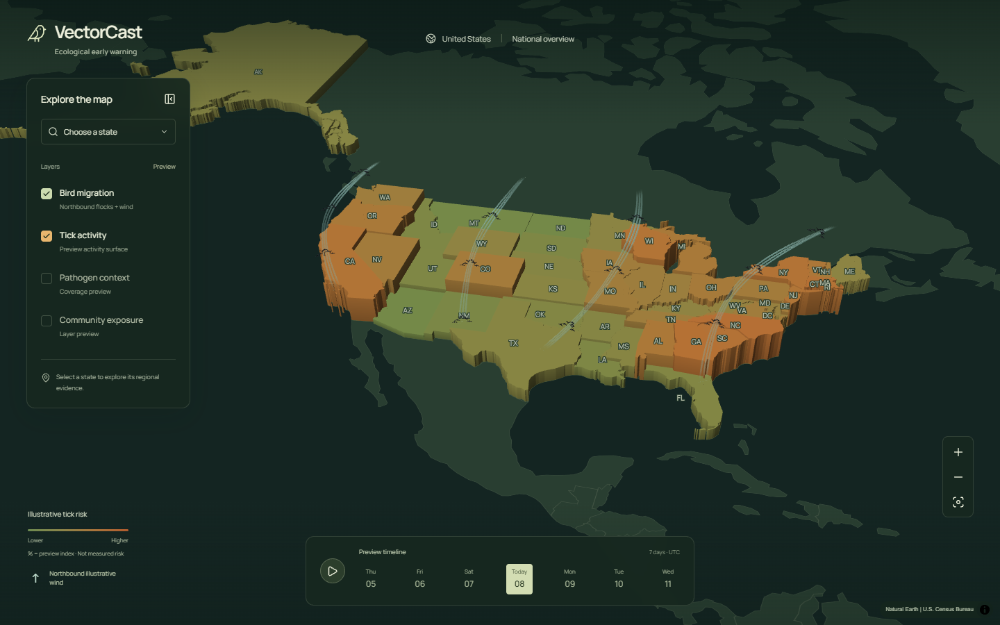
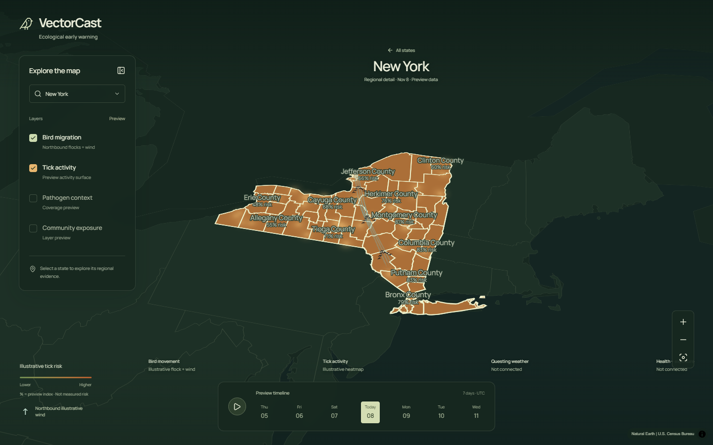
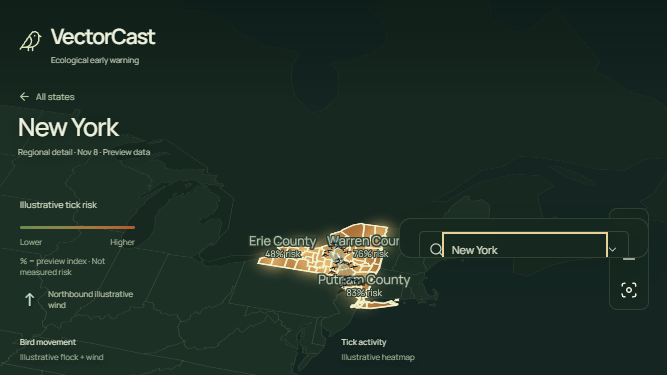
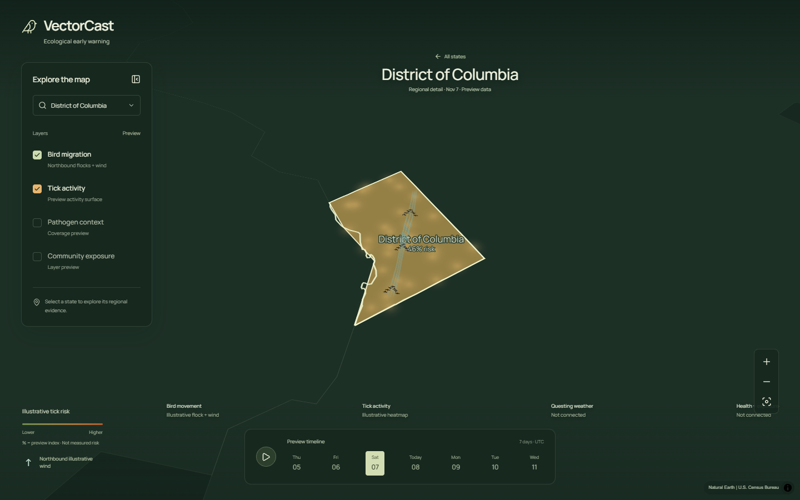

# VectorCast UI and performance audit

**Date:** November 7, 2026, America/New_York.
**Baseline:** `f56e614` (`codex/9-activity-blocks`).
**Working branch:** `agent/9-ui-audit-performance`.
**Coordination:** [issue #9](https://github.com/brzozs/MSM-2026/issues/9).

## Verdict

The main preview flows work, and the performance changes substantially reduce repeated animation and map-worker work without changing bird geometry. The preview is not ready for an unconditional release approval: malformed state data can still blank the page, and responsive resizing, short landscape screens and degraded map access need follow-up.

This audit covers the implemented frontend, not the proposed ecological backend. Unconnected observations, weather, pathogen data and exposure data are explicitly future work; they are not counted as implementation defects here.

The review includes application source, styles, configuration, dependency lockfile, geography fixtures and preparation scripts. Browser evidence was captured fresh in this audit using approved headless tests against the local Vite preview. No desktop mouse/keyboard automation was used for the completed browser audit. VS Code can display the same local preview URL.

## What changed in this branch

1. **Bird models are shared by wing phase.** The previous renderer rebuilt the same local body and wing geometry separately for all 84 birds. It now builds three phase models per frame, then applies each bird's existing position, formation, bearing and altitude. A reusable typed array holds the resulting vertices.
2. **Unchanged frames reuse GPU geometry.** Animation time, date, routes and zoom invalidate the mesh; ordinary repaints reuse it. GPU storage is allocated when the mesh size changes and updated in place otherwise. Resource cleanup resets both CPU and GPU caches.
3. **Timeline changes update values rather than city polygons.** County GEOIDs provide stable source identifiers. Daily updates send the changed county percentages/heights, preserving the shared county/city collision source. Static county/town boundaries update only when the geography changes.
4. **Graphics loss no longer leaves active effects using missing sources.** The renderer becomes unavailable during context loss, keeping timeline and state selection from crashing the React root. Restoration rebuilds the map and custom bird layer while retaining the selected state and date.
5. **Reduced-motion fits initialize city-label visibility correctly.** A zero-duration camera fit can complete before the zoom listener is attached. The effect now initializes its state when the map is stationary, preventing city mode from leaking between state selections.

The layout, synthetic values, geography files and color palette are unchanged. These changes are implemented locally and remain uncommitted, unpushed, unmerged and undeployed.

## Performance evidence

| Measurement | Baseline | Optimized | Interpretation |
|---|---:|---:|---|
| Bird mesh generation, median | 12.62 ms | 1.94 ms | 84.6% less CPU time in the final isolated Node sample |
| Bird mesh generation, p95 | 14.32 ms | 2.69 ms | 200 measured frames per implementation after warm-up |
| NC daily source payload | 10,710,911 bytes | 11,812 bytes | About 99.9% less payload to the two regional map sources |
| Static regional-boundary updates on a date change | One full replacement | None | Geometry is unchanged across dates |
| Bird uploads during unchanged-frame repaints | Repeated `bufferData` | None | Existing geometry is drawn again |
| Headless migration-render median | 5.90 ms | 1.80 ms | Diagnostic only: small samples and software WebGL |

The mesh test uses the national 84-bird scene, 22,428 vertices, a 4,000-meter scale, Node 24.13.0, 30 warm-up calls and 200 measured calls. Separate comparisons across 108 combinations of time, date, scale and national/regional/empty routes produced **exactly equal Float32 vertex arrays**, including positions, colors and opacity. Existing county values and city counts also matched before and after the source-update change.

The national vertex array contains 717,696 bytes. Reusing it removes roughly 20.5 MiB/second of repeated typed-vertex allocation at 30 updates/second; small model/feature objects still allocate. Route-count changes legitimately resize the array.

These are component and payload measurements, not a claim of 60 FPS. Chromium used SwiftShader software WebGL, which emitted readback/stall warnings. Actual desktop/mobile GPU frame rates, thermal behavior, battery use and slow-network startup still need real-device measurement. Large initial regional files also remain: North Carolina alone is about 5.73 MB of boundary JSON, plus the shared city-label source in memory.

Raw evidence: [CPU benchmark](ui-audit-evidence/cpu-benchmark.json), [browser performance and recovery checks](ui-audit-evidence/performance-and-edge-results.json).

## Remaining findings

### 1. P2 — Malformed state data blanks the entire page

**Location:** [App.tsx](../../web/src/App.tsx#L24).
**Reproduction:** Return HTTP 200 with `{"type":"FeatureCollection","features":[{}]}` for `/data/states.geojson`.
**Observed:** The React root becomes empty with `Cannot read properties of undefined (reading 'code')`. The response is cast to a TypeScript type without runtime validation; the render failure happens after the fetch catch has finished.
**Recommendation:** Validate required collection, feature, property and coordinate shapes before storing the response. Reject malformed/empty input through the existing geography error state. An error boundary would provide additional containment.

### 2. P2 — Some basemap failures are silently ignored

**Location:** [MapCanvas.tsx](../../web/src/map/MapCanvas.tsx#L122).
**Reproduction:** Return HTTP 200 with HTML instead of JSON for `/data/countries.geojson`.
**Observed:** The map has no fallback or degraded-status message, and navigation remains enabled despite the missing basemap. A network abort did activate fallback in this run, so the problem is not every network failure.
**Recommendation:** Identify the failed source through structured event information such as `sourceId`; do not depend only on a filename appearing in the exception text. Show an explicit degraded state and recovery action.

### 3. P2 — Short landscape screens hide the timeline and collapse the panel

**Location:** [styles.css](../../web/src/styles.css#L29), mobile panel rules.
**Reproduction:** Use a 667×375 viewport, select New York and open Map layers.
**Observed:** The shell remains at least 540 px tall, the timeline begins at y=422 outside the visible viewport, and the panel is only 40 px high. Opening it scrolls the selector into that narrow strip. Its heading, close control and layer options are difficult to reach together.
**Recommendation:** Add a short-height layout that keeps date/playback controls visible and gives the layer panel a usable scrolling area. Check landscape independently from portrait width breakpoints.

### 4. P2 — Resizing retains the old fitted camera

**Location:** [MapCanvas.tsx](../../web/src/map/MapCanvas.tsx#L217).
**Reproduction:** Select New York at 1440×900, then resize to 390×844.
**Observed:** Zoom remains 5.6045 and desktop padding remains 175/195/65/65. New York's projected geometry spans x=-90.6 to x=459.0 on a 390 px viewport, clipping both sides. Freshly loading the same portrait size fits correctly.
**Recommendation:** Recompute the selected-region fit when the usable viewport crosses a layout breakpoint or changes size materially. Debounce resizing and preserve user-controlled camera movement where appropriate.

### 5. P2 — Some layer toggles provide no map response

**Location:** [MapCanvas.tsx](../../web/src/map/MapCanvas.tsx#L181), [mapStyle.ts](../../web/src/map/mapStyle.ts#L24).
**Reproduction:** Enable Pathogen context nationally; or enable Community exposure while Tick activity is active.
**Observed:** Checkbox/legend state changes, but the relevant map output does not. Pathogen rendering is restricted to state focus, and the tick color expression takes precedence over the community flag. These are previews, but their usable conditions are not explained by the controls.
**Recommendation:** Disable unavailable combinations with a concise explanation, indicate that state selection is required, or provide a visible preview response consistent with the label.

### 6. P2 — The non-WebGL and keyboard paths lack equivalent metric access

**Location:** [MapCanvas.tsx](../../web/src/map/MapCanvas.tsx#L280), [StateFocus.tsx](../../web/src/components/StateFocus.tsx).
**Reproduction:** Disable WebGL, then select a state; alternatively navigate the normal interface using only a keyboard/screen reader.
**Observed:** State selection and source-status text remain available, but there is no list/table exposing the state/county percentages painted on the map. The fallback image only covers the contiguous states/DC, including when Alaska or Hawaii is selected.
**Recommendation:** Provide a concise selected-region value/availability table that works independently of the canvas, with an appropriate geography fallback for AK/HI. Automated accessibility scans do not detect the missing canvas information equivalence.

### 7. P3 — Clearing a mobile selection loses keyboard focus

**Location:** [App.tsx](../../web/src/App.tsx#L68).
**Reproduction:** At mobile width, select a state, reopen Map layers, focus the selector and choose its empty option.
**Observed:** The panel becomes inert and focus moves to `BODY`. The new-state heading focus effect does not run because the selection was cleared.
**Recommendation:** Return focus to the Map layers trigger when clearing a selection closes the panel, as the explicit minimize action already does.

### 8. P3 — Concurrent error banners overlap

**Location:** [MapCanvas.tsx](../../web/src/map/MapCanvas.tsx#L282), `.regional-geography-status` in [styles.css](../../web/src/styles.css).
**Reproduction:** Fail both county-label and regional-boundary requests, then select New York.
**Observed:** Both status elements occupy y=220 with a height of 26 px, so one message obscures the other.
**Recommendation:** Stack these messages in a shared status container or combine them into one concise error summary.

### 9. P3 — Small text and HUD occlusion weaken legibility

**Evidence:** Screenshots below; timeline day labels are 7 px in the mobile rules, and several legend/status labels are 8–9 px. In the desktop state view, the rightmost Health + exposure status sits behind the zoom/reset stack.
**Recommendation:** Increase key date/legend/status text and reserve space for the navigation controls. Keep the illustrative-data qualifier legible beside percentage values; `% risk` alone is easy to misread when the legend is cropped or overlooked. This is a visual usability finding, not an assertion that axe detected a contrast violation.

### 10. P3 — Development documentation describes removed behavior

**Location:** [README.md](../../README.md#L31).
**Observed:** The README promises 3D/2D/globe views and says state height is fixed. The current interface has no projection switch, and national height is derived from synthetic activity.
**Recommendation:** Update the instructions to match the current preview or explicitly identify those controls as future work.

## Verification and scope limits

| Area | Actual result |
|---|---|
| Existing and added unit tests | **21 passed, 0 failed** |
| TypeScript and production build | Passed in the actual task checkout and temporary verification copy |
| Locked dependency audit | **0 known vulnerabilities**, including development dependencies; lockfile unchanged |
| Main browser matrix | 20 scenarios inspected/completed; expected malformed-data fixture still reproduces finding 1 |
| Responsive sizes | 320×568, 360×640, 390×844, 667×375, 768×1024, 1024×768; desktop 1440×900 |
| Region interactions | NY, TX, CA, AK, HI and DC; county/city zoom transitions; rapid region changes |
| Dates and playback | All seven values changed; one selected date at a time; play advanced and pause remained stable |
| Focus and controls | Panel open/minimize focus; state heading focus; touch layer toggle; raised-state mouse picking |
| Graphics recovery | Loss followed by a date change no longer blanks the app; restoration recreates the map and bird layer with the selected state retained |
| Reduced motion | Static bird rendering; zero-duration region fits; default county mode retained across TX/CA/HI/DC |
| Automated accessibility | No axe violations in the scanned desktop and six responsive states |
| Geography fixtures | Existing tests cover all 51 selectable state/DC files and 3,144 unique county anchors, including holes and antimeridian cases |
| Source/error handling | State HTTP/schema, county HTTP, regional HTTP, country malformed JSON/network, WebGL disabled, context loss, simultaneous errors |
| Security-oriented source review | No application `eval`, arbitrary HTML insertion, browser credentials or backend write surface found in the inspected frontend |
| Diff hygiene | `git diff --check` passed; AGENTS.md, existing contributor work and the untracked MSM-2026 directory preserved |

Browser tools were Playwright 1.65.0, Chromium 158.0.8127.18 and axe-core Playwright 4.14.0. Audit-only browser packages were installed in a temporary copy; application dependencies were not changed. Python preparation scripts were inspected but not executed to regenerate the bundled geography.

The 20-scenario matrix reports that each scenario was exercised, not that every injected failure behaved correctly. Finding 1 remains the expected browser exception in the final matrix. The raw [UI results](ui-audit-evidence/optimized-results.json) distinguish scenario completion from observations. Additional evidence covers rotation/resizing, touch, focus loss and simultaneous error banners.

These checks do not establish full WCAG compliance, Safari/Firefox compatibility, a physical screen-reader workflow, real mobile GPU performance, network-throttled startup or scientific validity of the synthetic percentages. No live-data, authentication, backend, provisioning or deployment claims are made.

## Captured flow

### 1. National overview — baseline

The map dominates the screen, attribution is visible, and controls are named. This establishes the visual baseline; the geometry optimization preserves the original vertices exactly.

### 2. New York detail — optimized

County names/percentages, the selected date and unavailable-source labels remain visible. Note the small text and the rightmost source label beneath the navigation stack.

### 3. Short landscape — unresolved layout finding

At 667×375 the panel collapses to a strip and the timeline is below the captured viewport. This is a captured defect, not the intended mobile layout.

### 4. Recovered graphics — optimized

After losing the graphics context, changing the date and restoring the context, the selected DC view and custom birds render again.

## Follow-up order

1. Contain invalid state data and report all failed map sources explicitly.
2. Fix short-height layout and camera refitting across viewport changes.
3. Make placeholder layer states explicit and expose map values outside the canvas.
4. Repair mobile focus return, stack status errors, improve small text/spacing, and update the README.
5. Measure the resulting experience on named physical desktop/mobile devices before setting an FPS target.

The optimization diff still needs an independent current-PR audit before any authorized merge under AGENTS.md. This report records findings on the baseline and author-run verification of the new changes; it is not self-approval of a PR.
