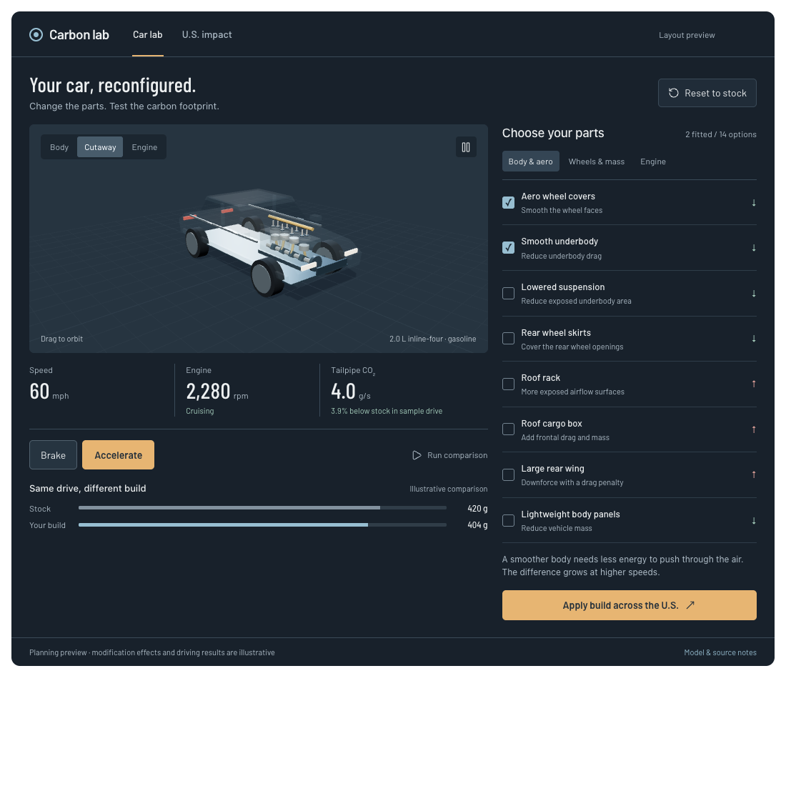
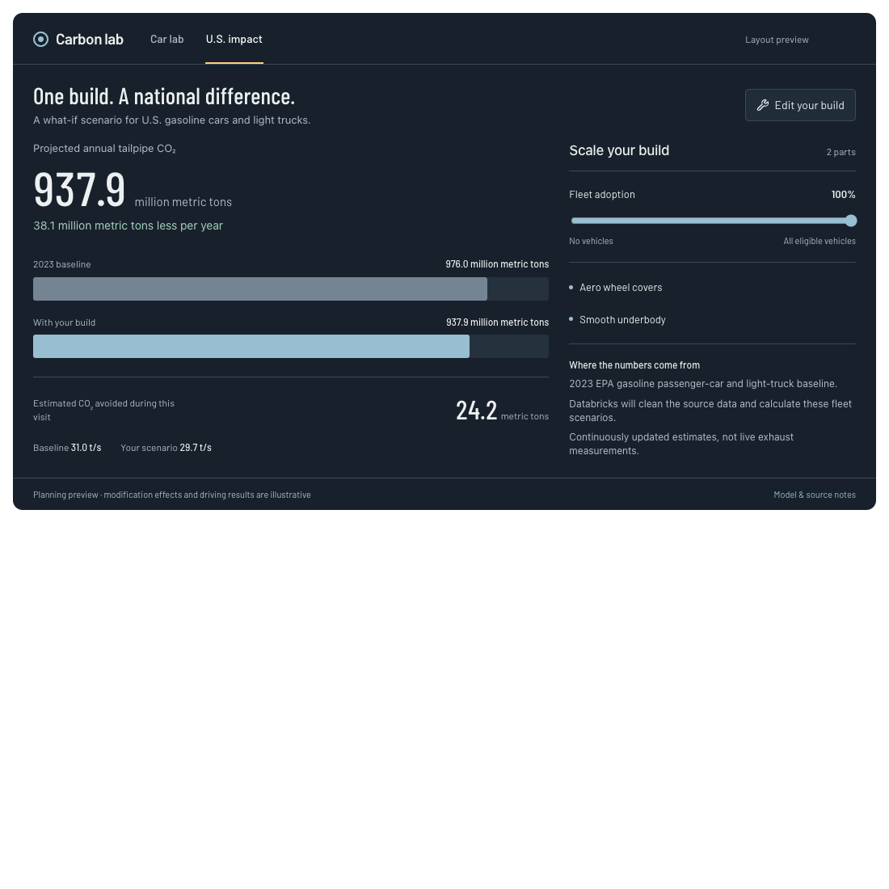

# Car Carbon Visualizer: design specification

Date: November 7, 2026. Planning issue: [#2](https://github.com/brzozs/HackRPI-2026-MSM/issues/2).

## Goal and agreed scope

Build a one-day hackathon demo that connects an individual car's design to its potential national CO2 impact. A visitor can inspect a car and its moving engine, accelerate and brake, fit helpful or harmful modifications, compare stock and modified emissions over the same drive, and apply that build to the U.S. gasoline passenger fleet.

The audience is hackathon judges and curious drivers. Success is a complete, explainable car-to-country demonstration, with a credible calculation underneath the visuals.

User decisions:

- Next.js/React web app; one day or less of build time.
- Polished technical car model with a detailed moving engine cutaway.
- Accelerator/brake controls plus a repeatable comparison run; no steering or driving game.
- A preset catalog covering the body, wheels, mass, and engine, including options that worsen CO2.
- CO2 only for v1; MPG and financial savings can come later.
- Databricks analytics as the sponsor integration; the team needs to create its workspace.
- A continuously updating U.S. estimate based on dated official data, rather than claiming real-time nationwide measurements.

Implementation defaults below are planning choices, not measured properties of a particular vehicle or validated aftermarket products. Do not present their assumed numerical effects as research findings.

## Screens and visual direction

Use two tabs in one shared application state: **Car lab** and **U.S. impact**. Keep selected modifications when switching tabs. Start stock, stationary, with a warm idling engine and 100% fleet adoption selected. No accounts, saved-build database, or cross-session persistence in v1.

### Car lab

- Large orbitable car viewport, with Body, Cutaway, and Engine views; zoom and reset camera.
- Cutaway hides or ghosts the body. Engine view focuses on four pistons, connecting rods, a crankshaft, cam/valve motion, and four-stroke combustion highlights. Engine and wheel motion respond to the simulation; slow the internal animation for legibility and label that behavior.
- Accelerator and brake work while held, including keyboard equivalents; release/blur/tab changes clear held controls. Cap speed at 90 mph. With neither pedal pressed, coast under the modeled resistance. Brake wins if both are pressed.
- Display speed in mph, engine speed in rpm, instantaneous CO2 in g/s, and stock-versus-modified total grams for a reference drive. Explain the basis of each comparison.
- Group the 14 options into Body & aero, Wheels & mass, and Engine. Show fitted state, mechanism, and computed effects. Do not advertise a guaranteed fixed CO2 saving per part.
- Run comparison computes both builds on the fixed reference drive and plays the 120 seconds back over 20 seconds, labeled 6x playback. Both vehicles follow identical speed/acceleration samples. Changing parts cancels playback and recalculates. Free driving is separate from this reference result.
- Apply build across the U.S. opens the second tab with those exact parts.

### U.S. impact

- Compare annual baseline and scenario CO2 with labeled bars, annual reduction or increase, and estimated metric tons per second.
- Fleet adoption slider: 0-100%, default 100%. Show which parts are being applied and the eligible fleet scope.
- An elapsed-session counter integrates the displayed scenario rate over time. Label it as an estimate since the scenario began; reset it when the build or adoption changes. Never present it as observed emissions today.
- Show source year, source link, calculation assumptions, and Databricks connection/result status. An increased-emissions build must say "added" or "more," not positive "savings."
- No state map, daily feed, or historical chart is required for v1.

### Draft layout and polish requirement

The user liked the layout as a first draft but described it as looking "vibe coded." These screenshots preserve layout and interaction priorities, not a finished visual target. Their modification effects and drive totals are illustrative. The screenshots' initially fitted parts do not override the stock starting state above.

Keep the large technical viewport, compact instruments, categorized parts, and clear path to national impact. Refine the sedan's proportions, wheel arches, panel separation, lighting, and engine visibility instead of shipping an intersecting collection of boxes. Use a cool graphite/steel palette, restrained amber controls, Barlow/Barlow Condensed typography, and deliberate spacing. Avoid a generic card grid or decorative badges. Final design needs a dedicated browser critique at desktop and phone widths; use frontend-design guidance during implementation.

## Calculation model

Use one pure TypeScript model in the browser and Next.js server. Use SI units internally and explicit unit-bearing property names. Render animation separately from calculation steps; the scene must consume simulation state, not invent emissions.

### Illustrative stock parameters

| Parameter | Default |
| --- | ---: |
| Vehicle mass | 1,500 kg |
| Drag coefficient / frontal area | 0.30 / 2.2 m2 |
| Rolling-resistance coefficient | 0.010 |
| Air density / gravitational acceleration | 1.225 kg/m3 / 9.81 m/s2 |
| Thermal / drivetrain efficiency | 0.25 / 0.90 |
| Mechanical engine loss / accessory load | 1,500 W / 500 W |
| Gasoline energy density | 34,000,000 J/L |
| Warm idle fuel use | 0.8 L/h |
| Tailpipe CO2 per liter | 8,887 g per U.S. gallon / 3.785411784 L per U.S. gallon |

The CO2 conversion comes from [EPA's passenger-vehicle explanation](https://www.epa.gov/greenvehicles/greenhouse-gas-emissions-typical-passenger-vehicle). Other defaults are explicitly illustrative. Scope is a warm gasoline vehicle on a flat road; omit cold starts, hills, regeneration, upstream emissions, and manufacturing impacts.

At each fixed 0.05-second step:

1. Calculate drag as `0.5 * airDensity * dragCoefficient * frontalArea * speed^2` and rolling resistance as `rollingCoefficient * mass * gravity` while moving.
2. Calculate demanded wheel power as `max(0, (mass * acceleration + dragForce + rollingForce) * speed)`. Braking must never create negative fuel use or emissions.
3. While moving, calculate fuel rate from `(wheelPower / drivetrainEfficiency + mechanicalEngineLoss + accessoryPower) / (thermalEfficiency * gasolineEnergyDensity)`, bounded below by warm idle rate. While stationary, use warm idle rate directly unless stop-start has switched the engine off.
4. Apply rich-tune enrichment only when acceleration exceeds 0.5 m/s2. Convert liters burned to grams of CO2 and integrate rate over elapsed simulation time. Keep full precision internally.

For free driving, full accelerator requests 1.5 m/s2; full brake requests -3 m/s2. Clamp at zero and the speed cap. Coasting acceleration is negative resistance divided by mass. Evaluate stock and modified fuel demand on the actual same speed/acceleration samples for fair live comparisons; do not compare two unrelated pedal runs.

Use a 0.31 m wheel radius and a simplified five-speed automatic visual drivetrain: gear ratios 3.6, 2.1, 1.4, 1.0, 0.8; final drive 3.7; upshift thresholds 10, 20, 35, and 50 mph; rpm bounded to 800-6,500 while running. RPM is illustrative, not a calibrated engine map. Four-stroke firing order is 1-3-4-2, with internal motion slowed for inspection.

### Reference drive

Linearly interpolate the following `(timeSeconds, speedMph)` knots:

`(0,0), (10,0), (25,30), (40,30), (50,0), (60,0), (80,60), (110,60), (120,0)`.

Each sample carries explicit `propulsionRequested` intent: in free driving, accelerator held with brake precedence; in the reference, positive acceleration or nonzero speed. Stop-start can stop only while stationary with no propulsion request, resets its stationary timer on intent or motion, and charges its restart pulse once when leaving the off state.

Use the same 0.05-second step and independently initialized engine state for stock and modified runs. The reference includes idling, urban acceleration, and highway cruising. It is an educational synthetic drive, not an EPA certification cycle or a measured national driving distribution. National scenario ratio is `modifiedReferenceCo2Grams / stockReferenceCo2Grams`, never an instantaneous throttle reading. Version it as `mixed-reference-v1`.

### Modification catalog

These numerical deltas are **illustrative model presets**. Sources establish the mechanisms, not these exact component-specific effects. Every card's detail view must distinguish those two things. Resolve the complete fitted parameter set and rerun the model; never add claimed CO2 savings percentages.

| ID | Category / part | Parameter change from stock |
| --- | --- | --- |
| `wheel-covers` | Body: aero wheel covers | Drag coefficient -0.009; mass +2 kg |
| `undertray` | Body: smooth underbody | Drag coefficient -0.014; mass +4 kg |
| `lowered` | Body: lowered suspension | Drag coefficient -0.007; visual body height -0.03 m |
| `skirts` | Body: rear wheel skirts | Drag coefficient -0.008; mass +3 kg |
| `roof-rack` | Body: roof rack | Drag coefficient +0.016; mass +8 kg |
| `cargo-box` | Body: roof cargo box | Drag coefficient +0.075; mass +25 kg, including rack |
| `rear-wing` | Body: large rear wing | Drag coefficient +0.038; mass +6 kg |
| `light-panels` | Body: lightweight panels | Mass -75 kg |
| `eco-tires` | Wheels: low-resistance tires | Rolling coefficient x0.85 |
| `wide-tires` | Wheels: wide performance tires | Rolling coefficient x1.18; drag coefficient +0.010; mass +8 kg |
| `extra-cargo` | Mass: extra cargo | Mass +100 kg |
| `stop-start` | Engine: automatic stop-start | Stop after 3 stationary seconds; resume on propulsion request or vehicle motion, with a 0.001 L restart pulse |
| `low-friction` | Engine: low-friction engine parts | Mechanical engine loss 1,500 W -> 1,200 W while moving |
| `rich-tune` | Engine: rich high-load calibration | Fuel rate x1.08 when acceleration exceeds 0.5 m/s2 |

Roof rack and cargo box are one exclusive slot; cargo box already includes its rack. Eco and wide tires are another exclusive slot. Selecting one in the UI replaces the previous option. Reject contradictory external requests rather than silently double-counting. Other options can combine. A selection's effect is conditional: aero gains depend on speed; extra weight matters most under acceleration; stop-start helps only at stops. Do not force every nominally helpful part to save CO2 in every situation.

Body and wheel parts change visible meshes. Highlight the affected engine component/region for engine options; show stop-start physically stopping the mechanism. Add cargo geometry for extra weight. Lightweight panels use a distinguishable material rather than a new car asset.

Relevant mechanisms: [DOE/EPA energy flows](https://www.fueleconomy.gov/feg/atv.shtml) and [driving, drag, and load](https://www.fueleconomy.gov/feg/driveHabits.jsp). Catalytic converters are excluded from this CO2 catalog: [DOE describes their conversion of other pollutants](https://www.energy.gov/sites/default/files/2024-12/PGM%2520catalyst%2520supply%2520chain%2520report%2520-%2520final%2520draft%25202.25.22%5B1%5D.pdf).

## Databricks and national data

### Baseline and provenance

Use the gasoline Passenger Cars and Light-Duty Trucks rows in Table 3-13 of the [EPA 1990-2023 inventory](https://nepis.epa.gov/Exe/ZyPURL.cgi?Dockey=P101EZHC.txt). Import the table's reported years 1990, 2005, and 2019-2023 into a checked-in CSV, preserving source URL, table, fuel, vehicle category, year, and source units. Verify transcribed cells against the official table before loading.

The v1 display uses **2023: 293.6 + 682.4 = 976.0 million metric tons of CO2**. Include gasoline cars and gasoline light-duty trucks/SUVs; exclude diesel, EVs, motorcycles, heavy freight, aircraft, and other transport. Use the CO2 rows, not total greenhouse gases. Do not relabel this source as 2026 observed data.

Create a reproducible Databricks notebook that loads the CSV into a raw Delta table, validates categories/units/duplicates/missing cells, and produces a clean table in metric tons. Preserve source metadata. Default namespace: `workspace.carbon_lab`; tables `raw_vehicle_emissions` and `vehicle_co2_baseline`. Upload the checked-in source CSV rather than depending on Free Edition outbound internet access. A third-party data API or streaming service is unnecessary for v1.

### Projection and integration

Let `baseline` be eligible annual metric tons, `adoption` be a fraction from 0 to 1, and `ratio` be the shared model's reference-drive result. Databricks executes the aggregate scenario:

`projected = baseline * ((1 - adoption) + adoption * ratio)`

`avoided = baseline - projected`

Convert annual metric tons to estimated metric tons per second using the baseline year's duration (2023 has 31,536,000 seconds). Explain that all participating vehicles are assumed to achieve the same proportional result as the demo car, with unchanged mileage. This is a what-if extrapolation, not a calibrated prediction for every U.S. vehicle.

The Next.js server recomputes the ratio from allowed part IDs; it never trusts a browser-supplied saving or SQL string. Send the ratio and adoption as bound SQL parameters. Databricks handles data cleaning, annual/category aggregation, and fleet projection, making the sponsor integration visible in the data flow rather than decorative branding.

Use the [SQL Statement Execution API](https://docs.databricks.com/aws/en/dev-tools/sql-execution-tutorial). Keep `DATABRICKS_HOST`, `DATABRICKS_TOKEN`, and `DATABRICKS_SQL_WAREHOUSE_ID` server-only. Use a short-lived, least-permission workspace token for the demo; never use `NEXT_PUBLIC_` secrets or log authentication headers. Read [Free Edition limitations](https://docs.databricks.com/aws/en/getting-started/free-edition-limitations) during setup.

- First milestone: account creation, a SQL warehouse, and a successful authenticated `SELECT 1` from the intended server environment. A teammate handles sign-in and token creation privately.
- API requests occur when the national tab opens or committed selections change, not at animation-frame frequency. Debounce the adoption slider by 300 ms; cancel or ignore superseded responses.
- Use inline JSON results, a 10-second SQL wait timeout with cancellation, and a 15-second HTTP deadline. Show loading and a retryable error for a cold, unavailable, unauthorized, or quota-limited warehouse. Prewarm the warehouse before judging.
- Keep the Car lab working when Databricks is down. Do not silently substitute invented national values or claim Databricks is connected after a failed request. Previously displayed figures must not appear current for a different build.

## Technical boundaries and acceptance

Use Next.js App Router with TypeScript, React Three Fiber/Three.js and Drei for scene controls, regular CSS, Vitest for the calculation core, and Playwright for a small number of browser flows. Use semantic HTML/SVG for simple comparisons; no charting framework or general state-management library is needed. A client state provider carries the current build and simulation; a Node-runtime route connects to Databricks. Generate the generic car and engine procedurally during the event; no external licensed car asset or dependency on the earlier B58 project.

Client/server boundary: `POST /api/fleet-impact` accepts `{ modificationIds: string[], adoptionPercent: number }`. It returns source year/scope/URL, model and reference-drive versions, the canonical selected IDs and adoption, baseline/projected/avoided annual metric tons, and their per-second rates. Unknown IDs, duplicate IDs, conflicting slots, non-finite values, or adoption outside 0-100 return HTTP 400 with an explicit error. Upstream/credential failures return a useful 503 without secrets. No browser credential or SQL input is accepted.

Acceptance means:

1. A visitor can orbit, zoom, use the cutaway, see coordinated engine motion, accelerate, brake, pause, and reset without stuck controls or a second simulation loop.
2. All 14 options work, affect the right model parameters, show the right visible change/highlight, and obey slot rules.
3. No modifications produces exactly matching stock and modified reference totals. Fuel and CO2 never go negative; stationary output avoids g/mile division.
4. Applying a build preserves its selection and uses the shared reference ratio. Zero adoption equals baseline; 100% adopts the full modeled effect; harmful builds increase national totals.
5. The national data actually passes through Databricks; verified source year and scope are visible. Failures are explicit, and secrets remain server-only.
6. The demo works at 1440px, 1024px, and 390px without clipped controls; keyboard input and reduced motion work. With WebGL unavailable, show a clear message and retain non-3D calculation controls.

## One-day delivery priorities

Assume three contributors, without assigning personal roles. One owns the shared model/contracts, one owns the 3D scene and visual integration, and one owns Databricks/API work. Claim separate issues and branches, agree on shared files, and use independent audits on current PR diffs per AGENTS.md. This planning commit does not repeat the initial direct-to-main exception.

Start Databricks onboarding immediately. Deliver the end-to-end path with stock + one helpful + one harmful part first, then complete all 14 catalog options, engine detail, and polish. If time runs short, drop secondary engine labeling, sound, camera flourishes, and extra charts; retain the engine cutaway, required catalog, fair comparisons, and genuine national integration. No AI coach, voice API, CFD, multiple car models, other exhaust pollutants, MPG/cost UI, or full driving environment in this build.

The [event page](https://hackrpi.com/event/) lists Sustainability and Databricks tracks, submission at 9:00 a.m. Sunday, November 8, edits until 11:00 a.m., and no later changes (America/New_York). Target a working demo before the submission deadline, reserving the final hours for checks and presentation. Verify the organizer's current instructions before submission.
