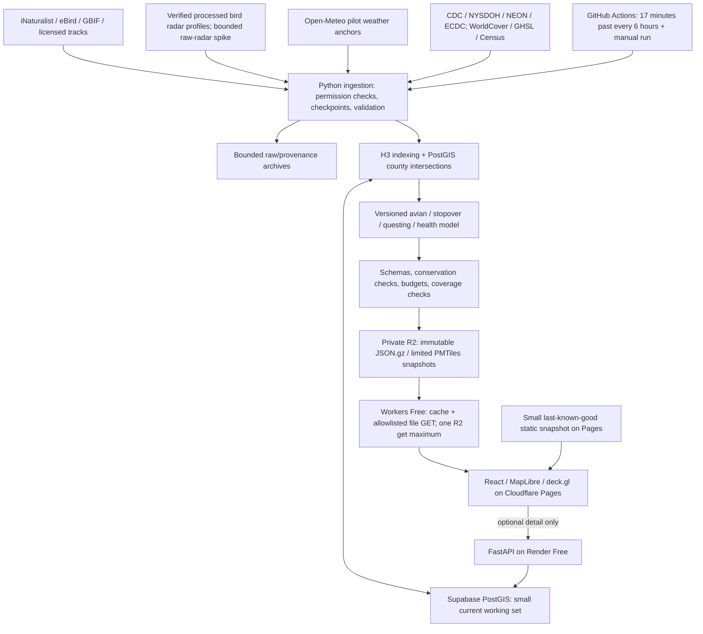

# Ecological Early-Warning Platform: Project Design

**Date:** November 7, 2026. **Status:** proposed implementation design; documentation only.

**Source of product requirements:** [`prompt.txt`](../../../prompt.txt) on `prompt`, commit `bd286e751e8638f76fb473fb812a152b0c5b4513`.

**Coordination:** [issue #6](https://github.com/brzozs/HackRPI-2026-MSM/issues/6), branch `plan/ecological-early-warning`. Read [source/operations decisions](2026-11-07-ecological-sources-and-operations.md), [technical contracts](2026-11-07-ecological-data-and-model.md), and the [implementation plan](../plans/2026-11-07-ecological-early-warning.md) together with this document.

## 1. Executive summary and naming

Build an interactive ecological early-warning website whose landing page is a full-screen global map. It connects four questions: where birds are moving or being reported, where conditions could favor stopovers and tick questing, what pathogen evidence exists, and which populated communities overlap those conditions. Preserve the prompt's **Avian Influx, Stopover Drop, Questing Microclimate, and Community Pathogen Impact Index** concept.

The distinctive experience is the relationship between these signals. Clicking a location should explain what is observed, what is inferred, how old each input is, and what is unavailable. A moving line represents a verified bird track or an explicitly modeled corridor. It never represents an individually tracked tick. The composite is an experimental prioritization index; it does not estimate a person's infection probability or future case counts.

Five naming proposals, with no trademark/domain availability claim:

| Name | Rationale |
|---|---|
| **VectorCast** | Working name; covers ecological vectors and changing conditions. |
| FlywaySignal | Emphasizes migration and observable evidence. |
| QuestCast | Short consumer name centered on questing conditions. |
| StopoverWatch | Highlights the bird-stopover mechanism. |
| EcoFront | Fits regional surveillance and emerging evidence. |

The following are planning choices made by the author, rather than additional user requirements: Vite instead of Next.js, Cloudflare Pages as the primary static host, a New York/Northeast pilot, a Python batch model, and locally saved areas before accounts. They keep the core product while reducing the first build's operational burden.

## 2. Scope, constraints, and first proof

### Global constraints

- Operating budget: **$0.00; no paid upgrades, metered overages, or purchased domain.** Prefer losing freshness or temporarily disabling a service to spending money.
- React 19, TypeScript, Tailwind CSS, Vite, MapLibre GL JS, and deck.gl form the web client. Python 3.13, FastAPI, PostGIS, H3 v4, and GitHub Actions support data work. Pin mutually compatible stable packages and lockfiles during implementation.
- Static snapshots serve the landing experience; **at least 95% of landing sessions must make zero FastAPI or Supabase requests.** The static R2 gateway is a file delivery service, not the modeling API.
- H3 indices are strings; longitude/latitude order is explicit at every boundary; computation timestamps are UTC.
- Keep observations, estimates, forecasts, surveillance periods, source precision, licenses, and missing data distinguishable in every output.
- Never present county-to-cell allocation as measured local pathogen prevalence, bird sightings as measured migration, or resident population as actual outdoor exposure.
- Start with a global basemap and honest coverage masks; compute detailed pilot data before expanding. Never create a dense worldwide resolution-7 forecast grid.
- No application code, dependency installation, provider provisioning, deployment, commit, push, or merge is part of this planning task.

### Intended scope

The first demo supports live/recent tick and bird observations, a pilot weather forecast, explainable stopover/questing estimates, real regional health context, and population/habitat context. Globe/Mercator controls, all four layer controls, legends, source status, and a community drawer remain part of the product. Fine-scale health scoring is shown only where the input type and coverage support it.

The full roadmap adds processed radar/movement feeds, a seven-day historical and seven-day forecast scrubber, pathogen-evidence changes, locally saved-area alerts, optional authenticated institutional exports, and broader geographic coverage. Layers with unavailable data display their status, rather than a fabricated replacement.

The initial scientific pilot is New York State, beginning with the Capital Region and expanding to neighboring Northeast counties when source and compute budgets permit. The initial scored cohort is **Ixodes scapularis nymphs / Borrelia burgdorferi**, subject to a usable denominated surveillance dataset. The catalog retains Ixodes, Amblyomma, Dermacentor, Rhipicephalus, and Haemaphysalis observations globally. Additional species/pathogen/life-stage combinations get separate evidence and model configuration.

### Non-goals and failure conditions

Do not build individual tick tracking, diagnosis, clinical recommendations, a case prediction service, guaranteed global live coverage, paid notification delivery, a worldwide raw-radar processing cluster, or a custom particle engine for the first demo. A map with convincing movement but unsupported provenance, false local precision, hidden stale data, surprise billing, or a broken low-power fallback is a failed demo.

**First proof:** select a Capital Region county, inspect timestamped tick and bird observations, compare tomorrow's weather-driven suitability with today, open the county's actual health context and population baseline, and explain every displayed value from source to model. If prevalence is unavailable, the composite explicitly remains unavailable while the usable layers still work.

## 3. Core user flows

### Landing page and map

Open directly into a dark full-screen globe with a floating search/region selector, four layer toggles, a clear metric legend, projection control, source-status button, and time bar. Keep basemap attribution visible. Initialize from a small versioned manifest and coarse overview, then fetch viewport detail. Request geolocation only after the user selects “Use my location”; selecting a county works without permission or a geocoder.

The landing defaults to tick observations plus questing suitability where coverage exists. “Updated” shows both the snapshot build time and the relevant observation/forecast/health period. Unknown areas use a neutral coverage pattern, not the lowest color on a risk ramp. Forecast output carries a visible “Experimental estimate” label.

### Consumer exploration

A hiker or pet owner selects a county or searches the bundled pilot-region names. They toggle bird activity and stopover conditions, move between available dates, then click a cell. The drawer shows current conditions, recent reports, possible stopover conditions, health evidence, and the reason a score changed. It includes official source links and offers to save the area locally. Do not imply an exact safety boundary around a trail or a house.

### Public health/research exploration

A researcher selects a pathogen and tick cohort, switches between observed evidence and modeled index, and opens the county boundary. The drawer exposes numerator/denominator when provided, the surveillance window and geography, source resolution, quality exclusions, model version, and downloadable licensed aggregate evidence. Resident case counts and tick testing prevalence remain separate metrics. Records lacking redistribution permission are not included in downloadable bundles.

### Time and alerts

The completed scrubber spans UTC days D-7 through D+7. Each frame retains its own generation time and source periods. Past frames are published snapshots or genuinely archived inputs; uncollected history stays unavailable. Future frames use forecast weather and explicitly persisted/seasonal avian inputs, not future sightings. Days 4–7 carry a lower-confidence outlook label. The first alert feature is an in-app comparison of the latest complete snapshot with the previous complete snapshot for locally saved areas; it does not run when the app is closed. Email, push, and clinical alerting are deferred.

### Accessibility and degraded operation

Every control and the region drawer must work with keyboard and screen readers. Use readable opaque-backed text over the map, visible focus, non-color status indicators, and a reduced-motion setting that stops animation. A region evidence table and the same drawer remain usable when WebGL2, a basemap, a projection, or a layer is unavailable. On mobile, open one HUD panel at a time and keep the legend and selected date accessible.

## 4. System architecture and data flow

Choose one Python package for source adapters, spatial work, model calculations, and publication. FastAPI imports the contracts and reads published/current evidence; it does not run global models during requests. No microservices or generic ingestion framework are needed. Add a source-specific adapter only when a real source needs different handling. Scheduled jobs use a single concurrency group and publish the manifest last.

Supabase is a working catalog, not a global telemetry warehouse. Forecast arrays, raw radar, raster imagery, and historical cell frames stay out of its 500 MB database. The exact retention and cost guardrails live in the operations document.

## 5. Four-layer WebGL architecture

The four product layers are toggles over several rendering primitives. Pick at most one opaque thematic fill at a time; use boundaries, outlines, and moving strokes for the remaining layers. Use a fixed legend for each metric/version so changing days does not silently rescale colors.

| Product layer | Concrete renderer | Data and semantics | Blending / fallback |
|---|---|---|---|
| **1. Bird migration and stopover fallout** | `TripsLayer` for time-ordered licensed tracks or explicitly simulated vectors; `ScatterplotLayer` for eBird guild sightings; `H3HexagonLayer` for modeled stopover potential. | eBird ground-foraging guild observations; permission-checked Movebank tracks; NOAA-derived/European processed bird radar where verified; Open-Meteo precipitation, low cloud cover, wind. Sightings alone never generate observed travel paths. | Thin cyan trails and amber stopover outlines over the selected fill. Label synthetic corridors and historical playback. If no legal movement feed exists, show sightings/stopover inputs and “Movement feed unavailable.” |
| **2. Tick observations and questing conditions** | `HeatmapLayer` for reported points in flat mode; `H3HexagonLayer` for aggregated reports and computed suitability. | License-filtered iNaturalist and deduplicated GBIF/WRBU records; weather; WorldCover habitat. Observation intensity is separate from field-measured tick density. | One sequential suitability/report ramp; no additive stacking that changes values. Globe or low-power fallback uses preaggregated H3 cells. NEON measured abundance is a separately labeled point/plot product. |
| **3. Pathogen evidence and outlier frontier** | `PolygonLayer`/`GeoJsonLayer` for original county/region evidence; `ContourLayer` for a precomputed experimental evidence-change surface where supported. | CDC county tick-pathogen status; denominated NYSDOH/NEON testing; later ECDC region products. Contours describe changes in reported evidence or the modeled surface, not confirmed disease spread. | Magenta outlines above fill; no contour across unobserved gaps. Hide contours where sample/coverage gates fail; show original health polygons. Alpha-gal receives a distinct tick-associated allergy context, not a pathogen-prevalence input. |
| **4. Community population/exposure context** | `PolygonLayer` for counties and `H3HexagonLayer` for population/context or composite index. | GHSL population counts and Census geography; habitat overlaps; source-specific health data. Population is a resident-population proxy, not mobility, actual exposure, or social vulnerability. | Mutually exclusive population/composite fills with separate units. Only call a layer social vulnerability after integrating a licensed, dated vulnerability dataset. Missing population or prevalence means no composite. |

Use one shared WebGL2 context through the supported MapLibre/deck.gl integration. The current deck.gl guide recommends `MapLibreOverlay`; globe integration uses experimental `GlobeView`. Verify the actual stable packages before locking them. Interleaved Mercator is the reliable delivery path; enable globe overlays only after each chosen layer passes the compatibility spike. If an aggregation layer fails on the globe, render its precomputed H3/polygon equivalent; preserve a 2D control at all times. [Official integration guide](https://deck.gl/docs/developer-guide/base-maps/using-with-maplibre), [compatibility details](https://deck.gl/docs/api-reference/maplibre/overview).

### Performance budgets and lifecycle

- Overview: sparse H3 resolution 2/3; active regional cells: resolution 5; resolution 7 only for bounded prepared detail. Cap rendered cells at 10,000, visible observation points at 20,000, trajectories at 2,000, and total trail vertices at 50,000. These are initial project budgets, subject to measured reduction.
- One primary expensive heatmap/contour aggregation at a time. Aggregate values in Python, not in the browser on every frame. Use binary/typed buffers, stable layer IDs, memoized data, bounded caches, and deck.gl update triggers.
- Reuse buffers and update only the animation clock each frame outside React rendering. Pause when hidden, outside the selected time window, or reduced motion is requested. Dispose map, overlay, buffers, listeners, and animation frames on unmount and projection reset.
- Limit device pixel ratio to 1.5 initially and 1 on the low-power setting. Debounce viewport loads by 200 ms, cancel obsolete requests, and retain at most three decoded frames/32 MB of application layer data. No whole-world point or raster downloads.
- Targets: desktop median 60 FPS and p95 frame time at most 33 ms during a fixed 30-second pan; mobile/low-power median at least 30 FPS. Measure on named actual devices with all enabled layers and record cell/vertex counts. Headless browser checks alone cannot establish GPU performance.
- Target first useful map/evidence within 3 seconds on a recorded throttled broadband profile and compressed initial app+overview transfer under 2 MB excluding on-demand basemap tiles. The prompt's <100 ms is a warm-cache snapshot-response target, not a guaranteed cold page/globe render time.

## 6. Phased roadmap and proposed work split

| Phase | Shippable result | Exit gate |
|---|---|---|
| **1: Map and live observations** | React full-screen map, projection capability check, four labeled layer slots, live/recent iNaturalist/eBird snapshots, region drawer and provenance. | An observation can be traced to its source; missing credentials or unsupported projections do not break the app. Unimplemented model layers are explicitly unavailable. |
| **2: Automated ecology pipeline** | Six-hour ETL, H3 aggregation, habitat/weather context, stopover/questing components, versioned R2 bundles, static fallback. | Repeatable fixture run, last-good rollback, null propagation, spatial correctness, and quota checks pass. Legal movement data or labeled unavailability is demonstrated. |
| **3: Health and community interpretation** | County health metrics, conserving H3 allocation, population overlay, full time bar, explainable composite where eligible, and in-app saved-area change alerts. | No false prevalence downscaling; original geography/period and numerator/denominator remain visible; all four layers and degradation paths pass review. |
| **After pilot validation** | More regions/cohorts, validated processed radar, independently evaluated models, optional Supabase Auth/RBAC and institutional saved areas/exports. | Source permission, time/space coverage, validation, and monthly costs reviewed for each expansion. |

The first hackathon target is a coherent Phase 1 plus one Phase 2 county example, with genuine available health context. Full worldwide live forecasting and all integrations require follow-up work. The implementation plan gives a 24-hour cut line and preserves the full product roadmap.

Suggested lanes for Sebastian, Marco, and Matei are map/interaction, ingestion/model, and publishing/API/verification. The names are not assignments. Claim owners in issues before implementation; shared contracts land first and shared files have one owner. No agents are dispatched to implement in this planning task.

## 7. Top technical risks

| Risk | Concrete mitigation and proof |
|---|---|
| **Time/space resolution mismatch** between point reports, forecast grids, weekly ED regions, annual testing, and cumulative county status | Preserve observation, retrieval, issue, valid, and surveillance-period times separately. Intersect county polygons with H3 in PostGIS, conserve extensive quantities, preserve prevalence units/denominators, and keep categorical presence separate. Test two counties sharing one cell, leading-zero FIPS, future leakage, and suppressed denominators. |
| **Global GPU or memory exhaustion** | Sparse level of detail, prepared geometry, request cancellation, bounded typed buffers, one heavy fill, globe compatibility checks, reduced motion, context-loss recovery, and a region table fallback. Record desktop/mobile pan tests and ten repeated projection/unmount cycles. |
| **Supabase database exceeds 500 MB** | Keep only a capped pilot working set; export snapshots to object storage; enforce row/byte budgets and prune before ingestion; include indexes and PostGIS overhead in `pg_database_size`. Warn at 350,000,000 bytes and stop writes before 400,000,000 bytes. Test rejection before an oversized batch commits. |

Additional risks are feed access/reuse restrictions, observer-effort bias, radar processing cost, free-tier cold starts, cron delays, privacy-sensitive coordinates, and billing exposure. Each has an explicit fallback or admission gate in the operations document.

## 8. Acceptance and verification

The future build is acceptable when the following are demonstrated, not merely implemented:

1. Each of the four visual layers has a named source, timestamp, renderer, metric, legend, geographic coverage, and missing-data behavior.
2. A no-secret local fixture demo and a live pilot ingestion both work; fixtures are visibly labeled and never substituted as live data.
3. Unit tests pin the model equations and null/invalid-input behavior; PostGIS integration tests prove point/boundary/time joins and conservative allocations.
4. Browser tests prove date/layer/selection interactions, stale-data messaging, accessible controls, request cancellation, and table fallback. Actual-device checks record FPS and lifecycle behavior.
5. One hundred fresh landing sessions make zero requests to FastAPI/Supabase; initial static delivery, byte limits, and cache headers are measured. Optional detail failure leaves the core experience usable.
6. Public payloads contain only allowed fields and licensed records. No secrets, private coordinates, personal health data, or undocumented source precision escape.
7. A scheduled run cannot replace the last-good manifest with incomplete/unlicensed/oversized data; rollback and zero-budget shutdown are rehearsed.
8. The team can explain which model components are observations, proxies, heuristics, and unavailable evidence. No product copy claims validated infection probability or measured pathogen spread.

## Prompt coverage map

| Required prompt section | Location |
|---|---|
| 1. Executive summary, five names, user flows | Sections 1–3 here |
| 2. Static-first ETL and Mermaid architecture | Section 4 here; operations document |
| 3. Four-layer WebGL architecture / 60 FPS | Section 5 here |
| 4. PostGIS schema and resolution-5/7 allocation | Technical contracts, sections 2–4 |
| 5. API, static schemas, exact multistage formula | Technical contracts, sections 5–8 |
| 6. Three-phase implementation roadmap | Section 6 here; implementation plan |
| 7. Top three bottlenecks and mitigations | Section 7 here; operations guardrails |
| 8. Tests and verification standards | Section 8 here; implementation task checks |

This design is ready for review alongside its implementation plan. All implementation choices remain proposals until the team starts the authorized build.
